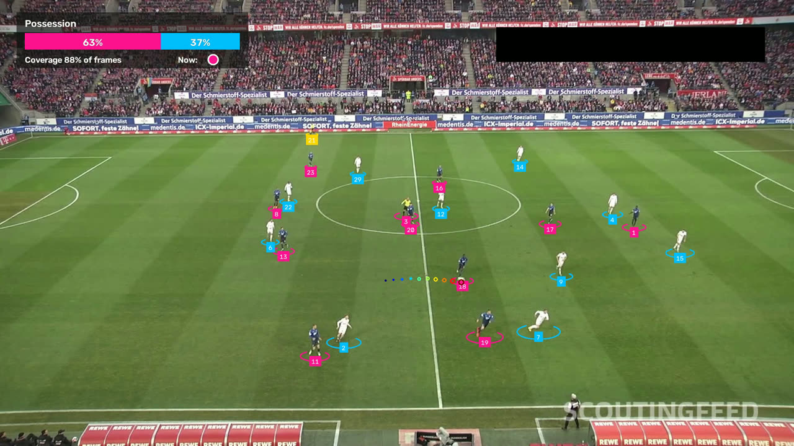

# Soccer possession tracking

Ball possession tracking for broadcast soccer footage, built on top of
Roboflow's open-source [sports](https://github.com/roboflow/sports) repo.
Roboflow's pretrained models and code handle player and ball detection,
tracking, and team classification. This project adds possession tracking on
top of them: who has the ball in each frame, possession % per team, and how
much of the video those numbers are based on.



*Frame 300 of a sample Bundesliga clip. Each player is tracked with an ID and
colored by team (pink or blue). Referees are yellow. The dotted trail is the
ball's recent path. The panel shows possession and coverage so far, and this
frame's call: pink, because dark-kit player 18 has the ball.*

> **Status:** Phase 1 (possession tracking) works end to end and has been
> checked on one 30-second clip. The two possession settings are still at
> their starting values and haven't been tuned yet.

## What it does

1. Finds the players, goalkeepers, referees and ball in every frame, and
   follows each player from frame to frame with a tracking ID.
2. Sorts the players into two teams by how their crops look
   (SigLIP image embeddings + UMAP + KMeans clustering). It doesn't use a
   hand-picked jersey color.
3. Decides who has the ball in each frame, smooths out one-frame flickers, and
   adds up possession % per team.
4. Writes an annotated video, a JSON summary, and per-frame and per-player
   CSV files.

It processes recorded video offline, frame by frame. It is not a live system.

## Results

One sample clip (`2e57b9_0`: 30 seconds, 750 frames, 1920x1080), on a laptop
CPU with no GPU, at the starting settings (80 px, 5-frame window):

| | |
|---|---|
| Frames with a ball detection | 687 of 750 (91.6%) |
| Frames with a possession call (coverage) | 652 of 750 (86.9%) |
| Possession | dark-kit team 34.7%, white-kit team 65.3% |
| Player-frames whose team label differs from that player's usual team | 7.6% |
| Processing time | 9.4 s per frame (about 2 hours for the clip) |

These numbers show what the pipeline computes. The possession calls have not
yet been checked against hand-labeled footage, so they are not an accuracy
measurement.

The settings matter. Across a 9-setting sweep on the first 10 seconds, coverage
ranged from 69% to 97%, and the possession split from 31/69 to 46/54. See
[TUNING_LOG.md](TUNING_LOG.md).

More detail:
[docs/baseline_notes.md](docs/baseline_notes.md) (Roboflow's models on their
own) and [docs/pipeline_notes.md](docs/pipeline_notes.md) (the full pipeline).

## How possession is computed

`src/possession.py` has three functions, run in order on per-frame detections.

### `raw_call(ball_xy, players, max_distance_px)`

One frame's call, before smoothing.

- The player nearest the ball gets the call for their team if they are within
  `max_distance_px`. Distance is straight-line, from the ball center to the
  player's foot position, since that is where the ball is played.
- No ball detected, no players, or nobody in range: no call. A ball in flight
  always has a nearest player but nobody in possession, so the distance limit
  keeps those frames from being credited to whoever happens to be closest.
- A distance exactly at the limit counts as a call.
- Players from different teams exactly tied for nearest: no call, since the
  ball is contested. Tied players from the same team: that team.

### `smooth_calls(raw_calls, window)`

Removes one-frame flickers from the raw calls.

- Each frame takes the majority vote of the raw calls in a window of `window`
  frames.
- No-call frames don't vote. A short ball dropout doesn't erase possession,
  but a dropout longer than the window becomes no call.
- The window is centered on the frame. Processing is offline, so future frames
  are available, and centering keeps the call lined up with the frame it is
  drawn on. A trailing window would lag by about half a window. Windows are
  clipped at the start and end of the video.
- No votes, or a tied vote: no call. Without a majority the frame is
  uncertain, so it isn't given to either team.

### `possession_stats(smoothed_calls)`

- Possession % per team = that team's frames / frames with a call. No-call
  frames are excluded, never attributed to a team.
- Coverage % = frames with a call / total frames. A weak ball detector shows up
  as low coverage instead of being hidden behind confident possession numbers.

The two settings start at 80 px and 5 frames in `src/config.py`.

## Known limitations

- **Team labels can change between frames.** The team classifier labels each
  player independently in every frame. It is least reliable when two players
  overlap, and it needs enough footage to fit well: on a 2-second clip, the
  player with the ball switched teams in 40% of the frames he had it.
- **Team colors are clusters, not team names.** Which team is pink can swap
  between runs, and the classifier's fit varies slightly from run to run.
- **The distance limit is in pixels.** The same number of pixels covers more
  ground far from the camera than near it.
- **The ball detector sometimes finds more than one "ball"** (18% of frames) or
  a false one. Roboflow's ball tracker then keeps the candidate closest to the
  ball's recent path.
- **It is slow on CPU**, about 2 hours for a 30-second clip. Most of the time
  goes to ball detection.

## Setup

You need Python 3.10 or newer (this was built on 3.14) and ffmpeg, a
command-line tool for working with video. A regular CPU is enough. A GPU makes
it faster but isn't required.

```bash
# 1. Create a separate Python environment just for this project
python3 -m venv .venv

# 2. Install the exact package versions in requirements.txt.
#    --no-deps installs that list and nothing else. The top of
#    requirements.txt explains why this matters.
.venv/bin/pip install --no-deps -r requirements.txt

# 3. Download Roboflow's sports repo at the version this project was tested
#    with, then run its setup script, which fetches the pretrained models and
#    the sample match clips
git clone https://github.com/roboflow/sports.git third_party/sports
git -C third_party/sports checkout 42c80c0
PATH="$PWD/.venv/bin:$PATH" bash third_party/sports/examples/soccer/setup.sh

# 4. Run the tests to check everything is installed correctly
.venv/bin/python -m pytest
```

The models, videos, and the `third_party/`, `data/` and `outputs/` folders are
large or downloaded, so they're kept out of git (see `.gitignore`).

## Usage

Run the full pipeline on the default sample clip:

```bash
.venv/bin/python -m src.pipeline --target_video_path outputs/2e57b9_0_possession.mp4
```

Next to the video it writes a `.json` summary (possession, coverage, frame
counts, timings), a `.frames.csv` (ball position and calls for each frame),
and a `.players.csv` (each tracked player's position and team for each
frame). Use `--source_video_path` for another clip. `--max_distance_px` and
`--window` change the two settings for one run without editing
`src/config.py`.

Compare settings side by side. This runs the models once, then makes one video
per combination of settings:

```bash
.venv/bin/python scripts/tune_sweep.py --output_dir outputs/m5/first10s \
  --start_seconds 0 --duration_seconds 10
```

## Project layout

```
src/
  pipeline.py           video in -> detection, tracking, teams, possession -> annotated video
  possession.py         per-frame calls, smoothing, possession and coverage stats
  overlay.py            the possession panel drawn on each frame
  roboflow_example.py   loads Roboflow's soccer example so its helpers can be reused
  config.py             paths, device, and the two possession settings
scripts/
  tune_sweep.py         one video per combination of settings, plus a results CSV
  measure_ball_detection.py   Roboflow's ball detection with a per-frame count
tests/                  possession logic, the overlay, and config
docs/                   measured results and notes
TUNING_LOG.md           what each setting combination looked like
```

## Roadmap

- **Phase 1: possession tracking.** Built and checked on one clip. Setting
  tuning still to do.
- **Next (planned):** measure the possession calls against hand-labeled
  footage, and package the setup in a Docker image.
- **Phase 2 (planned):** map players and the ball onto a top-down view of the
  pitch with Roboflow's pitch keypoint model. That allows a distance limit in
  meters instead of pixels, and stats such as distance covered and possession
  by area of the pitch.
- **Phase 3 (stretch, planned):** jersey number reading, so stats can be tied
  to named players.

## Credits and licenses

- **[roboflow/sports](https://github.com/roboflow/sports)** (MIT License,
  Copyright (c) 2024 Roboflow). Provides the soccer example, the pretrained
  player/ball/pitch detection weights, the sample clips, ball tracking
  utilities, and the team classifier (SigLIP embeddings + UMAP + KMeans).
- **[supervision](https://github.com/roboflow/supervision)** (MIT). Provides
  ByteTrack tracking and the annotators.
- **[ultralytics](https://github.com/ultralytics/ultralytics)** (AGPL-3.0). The
  YOLOv8 runtime the detection weights use.
- The sample clips, and the frame shown above, come from the
  [DFL - Bundesliga Data Shootout](https://www.kaggle.com/competitions/dfl-bundesliga-data-shootout)
  Kaggle competition, via Roboflow.
